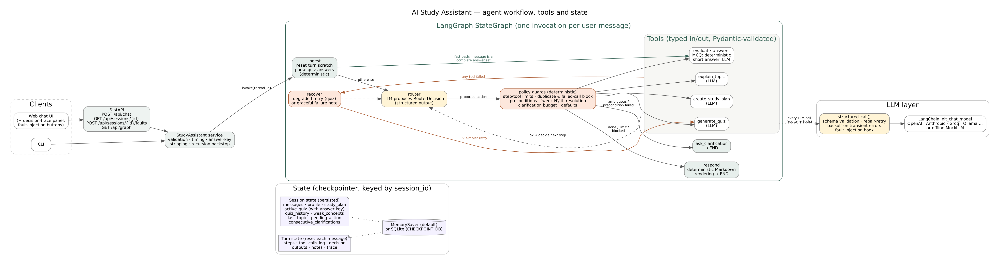
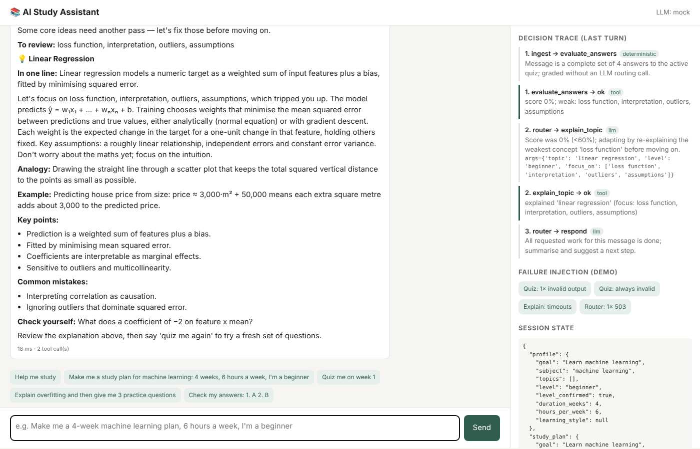

# 📚 AI Study Assistant — an agentic workflow with LangGraph

*Generative AI Intern Assessment, Problem Statement 3: Autonomous AI Assistant Using Agentic Workflows*

A study assistant that understands a student's goals, then **decides for itself** which step comes next: build a personalised study plan, explain a concept at the right level, generate a quiz, grade the answers, or ask a clarifying question. It keeps context across turns, changes its plan based on intermediate results (for example, a low quiz score triggers a focused re-explanation), and recovers from failed tool calls and invalid LLM output.

**Key idea:** *the LLM proposes, deterministic code disposes.* An LLM router picks the next action as a structured `RouterDecision`. A deterministic **policy layer** then checks that action against hard rules (execution limits, loop prevention, preconditions, reference resolution) before anything runs. Every step is logged in a **decision trace**, so you can see why each action was taken and who decided it.





---

## Features → requirements

| Requirement (PDF §3) | Where it lives |
|---|---|
| Goals, subjects, topics from the student | `ProfileUpdate` is extracted by the router on every turn and merged deterministically (`schemas.py`) |
| Understand the request, choose the next action | `router` node (LLM) → `policy.apply_policy` (deterministic) → conditional edges (`agent/graph.py`) |
| Personalised study plans | `create_study_plan` tool. Validated: correct week count and within the weekly hours budget. Weak concepts are scheduled first |
| Explanations for the student's level | `explain_topic` tool: level, learning style, and `focus_on` misconceptions |
| Quizzes and practice questions | `generate_quiz` tool: MCQ + short answer, schema-validated, answer key never shown |
| Evaluate answers + feedback | `evaluate_answers` tool: **MCQ graded deterministically**, short answers graded by the LLM |
| Context across interactions | LangGraph checkpointer per `session_id` (in-memory or SQLite) plus a structured session state |
| Multiple tools, chosen dynamically | 4 tools + `ask_clarification` + `respond`. Several tools can chain in one turn |
| Failed tool calls / invalid LLM responses | `structured_call` repair-retry + backoff → `recover` node (degraded retry or graceful message) |
| Clarifying questions | Router can ask. The policy also asks when preconditions fail, with a clarification budget so it can't loop |
| Structured outputs, retries, execution limits | Pydantic everywhere; `LLM_MAX_RETRIES`, `MAX_STEPS_PER_TURN`, `MAX_TOOL_CALLS_PER_TURN`, `TOOL_TIMEOUT_S`, recursion limit |
| API / UI | FastAPI (`/docs` for Swagger) + a single-page chat UI with a live decision-trace panel; CLI |

---

## Quick start

```bash
python -m venv .venv && source .venv/bin/activate     # Windows: .venv\Scripts\activate
pip install -r requirements.txt
cp .env.example .env
```

**Option A — offline (no API key).** `LLM_MODEL=mock` is the default. A deterministic, rule-based stand-in LLM runs the whole system: graph, policy, tools, retries, persistence and API. Use it for tests and reproducible demos.

**Option B — real LLM.** Set the model and key in `.env`, for example:

```bash
LLM_MODEL=openai:gpt-4o-mini        OPENAI_API_KEY=...
LLM_MODEL=anthropic:claude-haiku-4-5 ANTHROPIC_API_KEY=...
LLM_MODEL=ollama:llama3.1            # local, needs `pip install langchain-ollama`
```

Any provider supported by LangChain's `init_chat_model` and structured output works.

### Run

```bash
uvicorn study_agent.api.app:app --reload     # UI: http://localhost:8000   API docs: http://localhost:8000/docs
python cli.py --trace                         # terminal chat that prints the decision trace
```

### Test, demo, evaluate

```bash
pytest -q                                  # 59 tests: schemas, retries, policy, tools, end-to-end flows, API
python scripts/run_scenarios.py            # 5 multi-step scenarios → docs/DEMO_SCENARIOS.md (+ .json)
python scripts/eval_decisions.py           # 23 labelled decision cases → docs/eval_results_<model>.md
python scripts/eval_decisions.py --repeats 3   # also measures run-to-run consistency
```

Run the scenarios and the eval again with a real `LLM_MODEL` to get real-model numbers.

---

## Example (from `docs/DEMO_SCENARIOS.md`)

```
Student: Quiz me on week 1
  [1] router → generate_quiz (llm)      "asked for practice questions on week 1 of the plan"
        resolved 'week 1' from the study plan; args={topic: 'linear regression, gradient descent', num_questions: 4}
  [1] generate_quiz → ok (tool)
  [2] router → respond (llm)

Student: 1. A 2. A 3. C 4. not sure
  [1] ingest → evaluate_answers (deterministic)  "complete answer set; graded without an LLM routing call"
  [1] evaluate_answers → ok (tool)               score 0%; weak: loss function, interpretation, ...
  [2] router → explain_topic (llm)               "score <60%: adapting by re-explaining the weakest concept"
  [2] explain_topic → ok (tool)
  [3] router → respond (llm)

Student: Check my answers: 1. A 2. B        (no quiz exists)
  [1] router → respond (policy-override)   LLM proposed evaluate_answers → executed respond; no active quiz
```

---

## API

| Method | Path | Purpose |
|---|---|---|
| `POST` | `/api/chat` | `{message, session_id?}` → `{session_id, reply, trace, tool_calls, latency_ms, state}` |
| `GET` | `/api/sessions/{id}` | Public session state (profile, plan, active quiz **without** answer key, history) |
| `POST` | `/api/sessions/{id}/faults` | Queue faults for a task's next LLM attempts: `invalid_output`, `timeout`, `error`, `ok`. For demos; disable with `ALLOW_FAULT_INJECTION=false` |
| `GET` | `/api/graph` | Mermaid source of the compiled LangGraph |
| `GET` | `/api/health` | Status + active LLM |

---

## Project structure

```
study_agent/
  config.py            settings from env (.env)
  schemas.py           Pydantic models: RouterDecision, tool inputs/outputs, semantic validators
  state.py             AgentState: session state (persisted) vs turn state (reset each message)
  prompts.py           all prompts in one place
  llm/
    base.py            structured_call(): validation, repair-retry, backoff, FaultInjector
    langchain_llm.py   real providers via init_chat_model + with_structured_output
    mock_llm.py        deterministic offline LLM (tests/demos)
    mock_kb.py         tiny content base used only by the mock
  tools/
    base.py            ToolContext, ToolFailure, run_tool (timeout)
    study_tools.py     create_study_plan, explain_topic, generate_quiz, evaluate_answers
  agent/
    policy.py          deterministic guards, reference resolution, answer parsing
    nodes.py           ingest, router, tool nodes, recover, ask_clarification, respond
    graph.py           StateGraph + conditional routing
    render.py          deterministic Markdown rendering (no answer-key leaks)
    service.py         StudyAssistant facade (checkpointer, public state, faults)
  api/app.py           FastAPI + static/index.html chat UI
cli.py                 terminal client
scripts/               run_scenarios.py, eval_decisions.py
eval/decision_cases.json   labelled decision-quality cases
tests/                 pytest suite
docs/                  architecture, reasoning answers, decision log, evaluation, demo transcripts
```

## Documentation

- [docs/ARCHITECTURE.md](docs/ARCHITECTURE.md): workflow, state management, routing, LLM vs deterministic split
- [docs/REASONING.md](docs/REASONING.md): answers to the eight reasoning challenges
- [docs/DECISIONS.md](docs/DECISIONS.md): technical decision log (alternatives and trade-offs)
- [docs/EVALUATION.md](docs/EVALUATION.md): evaluation method, results, limitations, improvements
- [docs/DEMO_SCENARIOS.md](docs/DEMO_SCENARIOS.md): five multi-step scenarios with full decision traces

## Demo video outline (≈5 min)

1. Start the server and show the UI and the trace panel (30 s).
2. **S1:** plan → "quiz me on week 1" → wrong answers → automatic re-explanation → retry (90 s).
3. **S2:** "Help me study" → clarification → plan. Point out it never re-asks for known facts (45 s).
4. **S3:** press *Quiz: 1× invalid output*, then ask for a quiz. The trace shows the repair-retry. Press *Explain: timeouts*, then ask for an explanation. You get a graceful message and the next turn works (60 s).
5. **S5:** "Check my answers" with no quiz → policy override in the trace (30 s).
6. Show `pytest` and the eval report (30 s).

## AI tool disclosure

*(Edit this so it matches exactly how you worked.)* This project was built with an AI assistant (Claude). It was used to draft the code structure, implementation, tests and documentation from the assessment brief. I reviewed and ran all code and tests, checked the scenario traces, and I can explain every design decision recorded in `docs/DECISIONS.md`.
