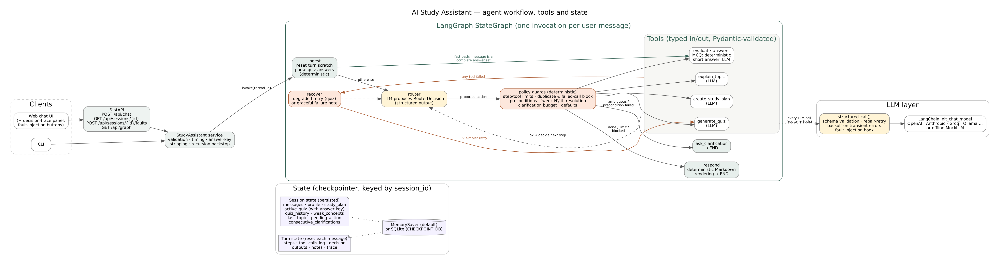

# Architecture

*(Source: `architecture.dot`. The exact compiled graph, auto-exported from LangGraph, is in `agent_graph.mmd`; you can also fetch it from `GET /api/graph`.)*

## 1. Components

| Layer | Responsibility |
|---|---|
| **Clients**: web UI, CLI | Chat; the UI also shows the decision trace, session state, and buttons that inject faults |
| **FastAPI** (`api/app.py`) | Request validation (length, session-id format), status codes, never leaks stack traces |
| **StudyAssistant** (`agent/service.py`) | Builds the graph and checkpointer, times turns, strips the quiz answer key from public state, catches the last-resort `GraphRecursionError` |
| **LangGraph StateGraph** (`agent/graph.py`, `nodes.py`) | The agent loop: ingest → router ⇄ tools → respond/clarify |
| **Policy** (`agent/policy.py`) | Deterministic guards on every proposed action |
| **Tools** (`tools/study_tools.py`) | Four typed capabilities; each has a Pydantic input and output |
| **LLM layer** (`llm/`) | `structured_call()`: one place for validation, repair-retries, backoff and fault injection. Provider-agnostic through LangChain `init_chat_model`; offline `MockLLM` |
| **Checkpointer** | `MemorySaver` (default) or `SqliteSaver` (`CHECKPOINT_DB`), keyed by `thread_id = session_id` |

## 2. One turn, step by step

1. **`ingest`** (deterministic) records the message and resets the turn scratch (steps, tool-call log, outputs, trace). If a quiz is active, it parses answers like `1. B 2) a 3. text`. If the message is *only* a complete answer set, it goes **straight to `evaluate_answers`**. No LLM routing call is needed, which saves latency and cost and removes one chance of a wrong decision.
2. **`router`** (LLM) gets a compact JSON state summary: profile, plan topics per week, active quiz (topic and size only), last topic, weak concepts, last evaluation, pending action, **this turn's tool-call log**, and the step count against the limit. It also gets the last *N* messages and the new message. It returns a validated `RouterDecision`: `action`, `reasoning`, arguments, and `profile_updates`.
3. **`policy`** (deterministic, inside the router node) may *override* the decision (§4). The trace records both the proposal and the override reason.
4. **Conditional edge** on `decision.action` → a tool node, `ask_clarification`, or `respond`.
5. **Tool node** builds the typed input from the resolved args and state, and runs the tool with a wall-clock timeout. On success it updates session state (plan / active quiz / history / weak concepts / last topic) and appends a render block. On failure it logs the error.
6. **After a tool:** success → back to **router**, which decides whether more work is needed (the agentic loop). Failure → **`recover`**.
7. **`recover`** (deterministic): for a failed quiz, retry *once* with a simpler request (≤3 MCQ-only questions). Otherwise add an honest, friendly note and return to the router. The policy blocks re-calling the failed tool in this turn.
8. **`respond`** renders all outputs and notes into Markdown with plain code (no LLM call), then adds the router's short message (summary or next step). **`ask_clarification`** asks one question and stores `pending_action`, so the next answer resumes the right task.

## 3. State management

| Session state (persisted per `session_id`) | Turn state (reset by `ingest`) |
|---|---|
| `messages` (LangGraph `add_messages` reducer) | `steps`: router iterations this turn |
| `profile`: goal, subject, topics, level, weeks, hours/week, learning style | `tool_calls`: action, args, status, attempts, error |
| `study_plan`, `active_quiz` (incl. answer key, server-side only) | `decision`: resolved action + args + source |
| `quiz_history`, `weak_concepts` (updated after each evaluation) | `outputs`: render blocks; `notes`: assumptions/failures |
| `last_topic` (resolves "it", "this") | `trace`: the decision trace returned to clients |
| `pending_action`, `consecutive_clarifications` | `parsed_answers`, `pending_retry` |

**Context comes from two sources.** (1) A *structured* state summary: facts the agent must not forget or hallucinate, such as plan weeks and the active quiz. (2) A *windowed* message history (`HISTORY_WINDOW`) for conversational nuance. Structured state does not grow with conversation length, so long sessions stay cheap. Values are plain JSON dicts, so any checkpointer backend can serialise them and the API can inspect them.

## 4. Policy layer: which guard does what

| Guard | Example |
|---|---|
| Step limit (`MAX_STEPS_PER_TURN=6`) | Forces `respond` |
| Tool-call limit (`MAX_TOOL_CALLS_PER_TURN=4`) | Stops a runaway agent that keeps finding *new* things to do |
| Failed-tool block | A tool that failed this turn is not called again this turn (only the explicit `recover` retry) |
| Duplicate block | Same action + same topic already succeeded this turn → `respond` |
| Preconditions | `evaluate_answers` with no active quiz → respond with an offer; no readable answers → ask for the format |
| Reference resolution | "week 2" → that week's topics; week out of range → clarify; no topic → last topic → profile topic → plan week 1 → clarify |
| Plan prerequisites | Subject + weeks + hours/week required → otherwise clarify, naming exactly what is missing |
| Clarification budget (`MAX_CONSECUTIVE_CLARIFICATIONS=2`) | After 2 questions in a row: plan with stated defaults (4 weeks / 5 h) and tell the student, or offer a menu. **Never** invents a missing subject |
| Backstop | LangGraph `recursion_limit=40` |

## 5. LLM vs deterministic split

| Deterministic code | LLM |
|---|---|
| Answer parsing and the fast path; MCQ grading; scores; weak-concept tracking | Understanding free-form requests and choosing the next action |
| Limits, loop prevention, preconditions, reference resolution, defaults | Extracting profile facts from natural language |
| Schema and semantic validation (week count, hour budget, 4 distinct MCQ options) | Writing plans, explanations and questions |
| Rendering replies; hiding the answer key | Grading free-text short answers against a reference |
| Retry/backoff/repair, timeouts, degraded fallback | Short summary / next-step message |

## 6. Failure handling summary

| Failure | Handling |
|---|---|
| LLM returns malformed or schema-invalid output | `structured_call` retries with a *repair prompt* that contains the validation error (≤ `LLM_MAX_RETRIES`) |
| Semantically wrong output (3 weeks for a 4-week plan) | Pydantic `model_validator` rejects it → same repair-retry |
| Timeout / 429 / 5xx | Exponential backoff retry |
| Tool still fails | `recover`: degraded retry for quizzes, otherwise a friendly note. State stays intact and the next turn works |
| Router LLM fails | Deterministic fallback reply; keeps any tool results already produced this turn |
| Short-answer grading fails | That question is marked "could not be auto-graded"; MCQ grades are kept |
| Unexpected exception in a tool | Converted to `ToolFailure`, so it never crashes the graph |
